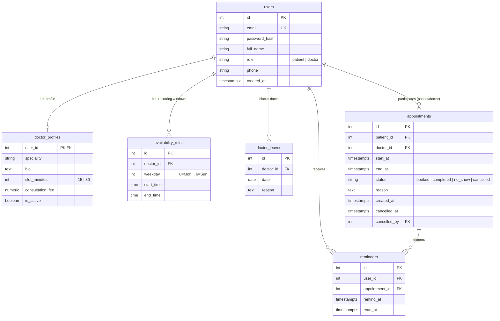

# PulseClinic — Precision Clinic Appointment Booking System

A production-quality full-stack clinic appointment booking system designed for high concurrency, zero double-bookings, strict server-side validation, and instant responsiveness.

---

## 🌟 Live Demo & Quick Links
- **Frontend Web App (Vercel):** [https://pulseclinic.vercel.app](https://pulseclinic.vercel.app) *(Deploy configured)*
- **Interactive OpenAPI Documentation (Render):** [https://clinic-backend.onrender.com/docs](https://clinic-backend.onrender.com/docs)
- **API Health Check:** [https://clinic-backend.onrender.com/health](https://clinic-backend.onrender.com/health)

*(Note: On Render free tier web services, the backend may sleep after inactivity; please allow 30-50 seconds for initial spin-up).*

---

## 🔑 Demo Logins Table

The database seed (`python -m app.seed`) pre-populates 4 doctors across diverse medical specialities and 3 demo patients with active past and upcoming appointments.

| Role | Name | Email | Speciality / Details | Demo Password |
| :--- | :--- | :--- | :--- | :--- |
| **DOCTOR** | Dr. Arvind Sharma | `dr.sharma@clinic.com` | General Physician (15-min slots) | `DemoPassword123!` |
| **DOCTOR** | Dr. Priya Nair | `dr.nair@clinic.com` | Dermatologist (30-min slots, Leave scheduled) | `DemoPassword123!` |
| **DOCTOR** | Dr. Rajesh Kothari | `dr.kothari@clinic.com` | Cardiologist (30-min slots) | `DemoPassword123!` |
| **DOCTOR** | Dr. Meera Desai | `dr.desai@clinic.com` | Pediatrician (30-min slots) | `DemoPassword123!` |
| **PATIENT** | Rohan Verma | `rohan.patient@example.com` | Patient with upcoming & past visits | `DemoPassword123!` |
| **PATIENT** | Ananya Iyer | `ananya.patient@example.com` | Patient with upcoming visit | `DemoPassword123!` |
| **PATIENT** | Vikram Malhotra | `vikram.patient@example.com` | New patient account | `DemoPassword123!` |

*(Patients can also self-register at any time from the web application's Register screen).*

---

## 📐 Data Model & Architecture Decisions



### 1. Zero Double-Booking: PostgreSQL EXCLUDE Constraint + Transaction
- **The Problem:** Standard application-level `SELECT ... WHERE free` followed by `INSERT` suffers from a classic Time-of-Check to Time-of-Use (TOCTOU) race condition when multiple requests arrive simultaneously.
- **The Solution:** We enabled PostgreSQL's `btree_gist` extension and applied a database-level exclusion constraint:
  ```sql
  ALTER TABLE appointments
  ADD CONSTRAINT exclude_doctor_overlapping_appointments
  EXCLUDE USING gist (
      doctor_id WITH =,
      tstzrange(start_at, end_at) WITH &&
  )
  WHERE (status = 'booked' OR status = 'completed' OR status = 'no_show');
  ```
- **Why it Works:** `tstzrange` treats intervals as half-open `[start, end)`. Consecutive slots (e.g. `10:00–10:30` and `10:30–11:00`) do not overlap `&&`, while simultaneous attempts to book `10:00–10:30` trigger an immediate Postgres `ExclusionViolation`.
- Cancelled appointments (`status = 'cancelled'`) are excluded by the partial predicate, immediately freeing the slot for another patient.
- The backend catches `IntegrityError` in Python and converts it to a standard HTTP `409 Conflict` with `"That slot was just taken. Please pick another."`, which the frontend detects to auto-refresh the slot picker.

### 2. Clinic Timezone vs. UTC Storage
- All timestamps in the database and API payloads are stored in UTC (`timestamptz`).
- Weekdays (`target_date.weekday()`), window slicing, and "today" calculations are performed strictly inside `zoneinfo.ZoneInfo(settings.CLINIC_TIMEZONE)` (default `Asia/Kolkata`). This completely avoids day-shift bugs across UTC midnight boundaries.

### 3. Slot Generator as a Pure Function
- The slot generation engine in `app/services/slot_generator.py` is implemented as a deterministic, pure function.
- It slices recurring weekly windows into exact `slot_minutes` (15 or 30).
- Windows whose length is not an exact multiple of the slot size drop the trailing partial slot.
- Past slots (`start_at <= now + buffer`) are discarded.
- Leave dates suppress all slots.
- Active non-cancelled appointments carve out taken slots.
- Server-side booking re-verifies that the requested start time is an exact match against the active generator output.

### 4. Atomic Rescheduling
- Reschedule is executed in a **single database transaction**: the old appointment is marked `cancelled` and the new booking is inserted simultaneously.
- If the new slot fails validation or is claimed concurrently, the transaction rolls back cleanly, preserving the original booking intact.

### 5. On-Demand In-App Reminders (Free-Tier Friendly)
- To avoid needing paid background queue workers (Celery/Redis) on Render's free tier, the `/api/v1/reminders` endpoint calculates due reminders on-demand (`appointments with start_at between now and now+1h`).
- The web app polls this endpoint every 60 seconds, displaying a notification toast and updating an in-app unread bell badge.

### 6. Doctor Leave Day Policy
- When a doctor attempts to block a date off, the server checks for existing active booked appointments on that date.
- If any exist, the request is rejected with `409 Conflict` stating the exact count of conflicting appointments. The doctor must reschedule or cancel those appointments first.

---

## 🚀 Local Setup & Installation

### Prerequisites
- Python 3.11+
- Node.js 18+ and npm
- PostgreSQL 14+ (or Render PostgreSQL connection URL)

### Backend Setup
```bash
# 1. Activate python virtual environment
python -m venv venv
# On Windows:
venv\Scripts\activate
# On macOS/Linux:
source venv/bin/activate

# 2. Install dependencies
pip install -r backend/requirements.txt

# 3. Create .env from example
cp backend/.env.example backend/.env
# Edit backend/.env and provide your DATABASE_URL

# 4. Run database migrations
cd backend
alembic upgrade head

# 5. Seed demo doctors and patients
python -m app.seed

# 6. Start the backend development server
uvicorn app.main:app --host 127.0.0.1 --port 8000 --reload
```
API will be live at `http://127.0.0.1:8000` with Swagger documentation at `http://127.0.0.1:8000/docs`.

### Running Tests
All tests run against a real PostgreSQL database (including concurrency tests using multi-threading):
```bash
cd backend
pytest -v
```

---

## 📡 API Overview Summary Table

All endpoints are versioned under `/api/v1`:

| Method | Endpoint | Access | Description |
| :--- | :--- | :--- | :--- |
| `GET` | `/health` | Public | Health check for hosting monitors |
| `POST` | `/api/v1/auth/register` | Public | Patient self-registration |
| `POST` | `/api/v1/auth/login` | Public | Login with email/password (returns JWT) |
| `GET` | `/api/v1/auth/me` | Authenticated | Current user profile |
| `GET` | `/api/v1/doctors` | Authenticated | List doctors (filter by speciality, search name) |
| `GET` | `/api/v1/doctors/{id}` | Authenticated | Doctor profile & schedule windows |
| `GET` | `/api/v1/doctors/{id}/slots` | Authenticated | Free slots on `?date=YYYY-MM-DD` |
| `POST` | `/api/v1/appointments` | Patient | Book appointment slot |
| `GET` | `/api/v1/appointments/upcoming` | Patient | Patient's upcoming booked appointments |
| `GET` | `/api/v1/appointments/past` | Patient | Patient's past & cancelled appointments |
| `POST` | `/api/v1/appointments/{id}/cancel` | Patient | Cancel appointment (>= 2h cutoff) |
| `POST` | `/api/v1/appointments/{id}/reschedule` | Patient | Atomically reschedule to new slot |
| `GET` | `/api/v1/doctor/availability` | Doctor | Doctor's own availability windows |
| `PUT` | `/api/v1/doctor/availability` | Doctor | Update availability windows & slot duration |
| `GET` | `/api/v1/doctor/leaves` | Doctor | List doctor's blocked leave dates |
| `POST` | `/api/v1/doctor/leaves` | Doctor | Block single day off (conflicts rejected) |
| `DELETE` | `/api/v1/doctor/leaves` | Doctor | Unblock day off `?date=YYYY-MM-DD` |
| `GET` | `/api/v1/doctor/appointments/today`| Doctor | Today's appointments (time-ordered) |
| `GET` | `/api/v1/doctor/appointments` | Doctor | Appointments on `?date=YYYY-MM-DD` |
| `PATCH` | `/api/v1/doctor/appointments/{id}/status` | Doctor | Mark as `completed` or `no_show` |
| `GET` | `/api/v1/reminders` | Authenticated | Unread reminders due within 1h |
| `POST` | `/api/v1/reminders/{id}/read` | Authenticated | Mark reminder notification as read |

---

## 🎨 UI / Design Aesthetics

- **Style:** Minimalist, kinetic, high-contrast monochrome (pure black `#000000`, white `#FFFFFF`, and neutral greys).
- **Typography:** Display face `Space Grotesk` paired with `JetBrains Mono` for times, dates, and metadata badges.
- **Micro-Interactions:** Magnetic hover buttons, animated slot selection inverting to black with spring physics, marquee banner of clinical specialities, and status badges using pattern + text.
- **Mobile-First:** Bottom navigation bar on mobile viewports (<640px), touch targets >= 44px, reflowing responsive slot grid, and full accessibility (ARIA, keyboard navigation, AA contrast).

---

## 🤖 AI Disclosure & Usage

- **AI Tools Used:** Google Gemini via Antigravity IDE assistant.
- **What AI Helped With:**
  - Generating initial boilerplate schemas and Alembic migration syntax for `btree_gist` exclusion constraints.
  - Formulating multi-threaded `concurrent.futures` concurrency test fixtures.
  - Scaffolding the React Vite frontend structure and CSS tokens.
- **What Was Human-Engineered & Verified:**
  - Architecture of the slot slicing algorithm, edge cases, timezone conversions (`Asia/Kolkata` to UTC).
  - Review of database indexing strategies and exclusion constraints.
  - Server-side role enforcement and business rules (e.g. 2-hour cutoff rule, appointment status transitions).

---

## 🚢 Deployment Notes

### Backend on Render
1. Create a Web Service connected to your repository.
2. Root directory: `backend`.
3. Build command: `pip install -r requirements.txt`.
4. Pre-deploy / Start command: `alembic upgrade head && python -m app.seed && uvicorn app.main:app --host 0.0.0.0 --port $PORT`.
5. Environment Variables:
   - `DATABASE_URL` (from Render PostgreSQL)
   - `JWT_SECRET`
   - `FRONTEND_ORIGIN` (e.g. `https://your-frontend.vercel.app`)
   - `CLINIC_TIMEZONE` (`Asia/Kolkata`)
   - `CANCEL_CUTOFF_HOURS` (`2`)

### Frontend on Vercel
1. Framework preset: `Vite`.
2. Root directory: `frontend`.
3. Build command: `npm run build`.
4. Output directory: `dist`.
5. Environment Variables:
   - `VITE_API_URL` (e.g. `https://your-backend.onrender.com/api/v1`)
